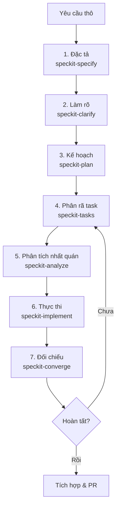

# Quy trình phát triển tính năng với Agent & Spec Kit (Specify)

Tài liệu này là nguồn chuẩn cho quy trình Spec Kit của LittleCafe Backend: cách
developer, agent và Spec Kit phối hợp để phát triển tính năng an toàn và đúng
cấu trúc. Bảng gate nằm trong `AGENTS.md` và không được lặp lại ở đây.

---

## I. Tổng quan

Nguồn ý định theo thứ tự trong `AGENTS.md`: yêu cầu đã duyệt trong
`littlecafe-docs`, contract machine-readable trong `contracts/`, rồi
`spec.md`/`plan.md`/`tasks.md`. Source code chứng minh trạng thái triển khai
nhưng không tự thay đổi yêu cầu.

---

## II. Hai cách chạy Spec Kit

- **Toàn bộ feature**: gọi skill `speckit-orchestrate`. Skill chạy
  `speckit-analyze` → `speckit-implement` → `speckit-converge`, sửa artifact
  trước khi sửa code, gate và commit một lần mỗi phase, rồi chỉ dừng khi không
  còn việc chưa làm.
- **Một bước đơn lẻ**: gọi trực tiếp `speckit-specify`, `speckit-clarify`,
  `speckit-plan`, `speckit-tasks`, `speckit-analyze`, `speckit-implement`,
  `speckit-converge`.

Cú pháp gọi phụ thuộc agent: `$speckit-orchestrate` (Codex),
`/speckit-orchestrate` (OpenCode/Claude), hoặc skill tool. Tên skill là chuẩn
chung, không phụ thuộc cú pháp.

Khi orchestrator chạy, nó giao việc cho worker (`speckit-worker`). Worker chỉ
chạy đúng một skill hoặc một phase được giao, không tự chọn feature, không Git,
không hỏi developer trực tiếp, không spawn subagent và không chạy full close-out
gate.

---

## III. Các giai đoạn

Khi bắt đầu một tính năng mới, tạo nhánh Git tương ứng (ví dụ
`feat/<feature-name>`) rồi chạy tuần tự các skill dưới đây.

### 1. Đặc tả tính năng (speckit-specify)

- **Mục đích**: phân tích yêu cầu thô và tạo `specs/[###-feature-name]/spec.md`.
- **Nội dung**: user story độc lập và kiểm thử được, yêu cầu chức năng, tiêu chí
  thành công đo lường được.
- **Nguồn**: requirement/workflow/ADR đã duyệt trong `littlecafe-docs`; không tự
  chốt quyết định mà nguồn chuẩn để mở.

### 2. Làm rõ đặc tả (speckit-clarify)

- **Mục đích**: quét `spec.md` để tìm điểm mơ hồ, thiếu hoặc mâu thuẫn; hỏi tối
  đa 5 câu trọng tâm rồi cập nhật câu trả lời ngược lại vào `spec.md`.

### 3. Lập kế hoạch thiết kế (speckit-plan)

- **Mục đích**: tạo `specs/[###-feature-name]/plan.md`.
- **Nội dung**: Constitution Check; data model; thay đổi contract OpenAPI,
  AsyncAPI và protobuf; thay đổi database schema; research thư viện.
- Contract machine-readable cập nhật trước implementation.

### 4. Phân rã công việc (speckit-tasks)

- **Mục đích**: tạo `specs/[###-feature-name]/tasks.md`, nhóm task theo user
  story, ghi chú `[P]` cho task song song và đường dẫn file cho từng task.
- **Bắt buộc**: quyết định bàn giao frontend phải tường minh (có guide hay ghi
  kết luận không đổi client surface); việc ngoài feature đi vào `deferred.md`.

### 5. Phân tích nhất quán (speckit-analyze)

- **Mục đích**: đối chiếu chéo `spec.md`, `plan.md`, `tasks.md` và constitution
  trước khi viết code; phát hiện trùng lặp, mơ hồ, thiếu coverage.
- Đây là bước read-only. Finding CRITICAL/HIGH phải sửa ở artifact, không sửa ở
  code để lách.

### 6. Thực thi code (speckit-implement)

- **Mục đích**: đọc `tasks.md`, thực thi theo phase, tick `[x]` khi hoàn thành.
- Chạy gate theo bảng trong `AGENTS.md`; không chạy `make check` giữa các phase.
- Nếu phát hiện việc ngoài feature, ghi `deferred.md` thay vì để lại checkbox.

### 7. Đối chiếu (speckit-converge)

- **Mục đích**: đối chiếu codebase với nguồn ý định, append task còn thiếu vào
  cuối `tasks.md` cho `speckit-implement` hoàn tất.
- Sau khi converge sạch: chạy full close-out gate (`make check`) một lần, đồng bộ
  `frontend-guide.md` nếu có client surface, rồi commit close-out.

---

## IV. Lệnh bổ trợ & quản trị

### 1. Checklist chất lượng yêu cầu (speckit-checklist)

- **Mục đích**: tạo checklist đánh giá chất lượng yêu cầu tại
  `specs/[###-feature-name]/checklists/`.
- Checklist tập trung vào chất lượng spec/plan, không chứa bước kiểm thử chức
  năng của hệ thống.

### 2. Quản trị constitution (speckit-constitution)

- **Mục đích**: khởi tạo hoặc cập nhật `.specify/memory/constitution.md`, tăng
  version và đồng bộ template liên quan.
- Constitution là tối cao; mọi thiết kế ở `speckit-plan` phải tuân thủ.

### 3. Đẩy task lên GitHub Issues (speckit-taskstoissues)

- **Mục đích**: chuyển task trong `tasks.md` thành GitHub Issues khi cần theo dõi
  bên ngoài.

---

## V. Nguyên tắc cốt lõi

1. **Constitution tối cao**: `.specify/memory/constitution.md` áp dụng cho mọi
   task, kể cả khi không chạy Spec Kit.
2. **Làm việc theo task nhỏ**: không yêu cầu agent viết toàn bộ feature cùng lúc;
   đi theo phase của `tasks.md` để kiểm soát chất lượng và tránh xung đột.
3. **Gate theo bảng trong `AGENTS.md`**: bảng đó là single source of truth. Không
   chạy `make check` sau từng user story; `make check` chỉ dùng ở close-out.
4. **Tài liệu trong `specs/`**: viết bằng tiếng Việt, commit cùng code và không
   xóa; đây là tài liệu đối chiếu về sau.
5. **Chủ động gợi ý bước tiếp theo**: sau mỗi giai đoạn, agent đề xuất skill kế
   tiếp thay vì trả việc lại cho developer.
6. **Phạm vi áp dụng**: Spec Kit dành cho task lớn, feature mới phức tạp. Với
   task nhỏ (hotfix, sửa docs, đổi config), Spec Kit là optional nhưng vẫn phải
   theo nguyên tắc cốt lõi và gate tương ứng.
7. **Bàn giao frontend**: feature đổi HTTP endpoint, event payload hoặc DTO
   client-facing phải có `specs/<feature>/frontend-guide.md`; chỉ đặt
   `READY_FOR_FRONTEND` khi contract, implementation, test evidence và sync check
   hoàn tất. Feature không đổi client surface phải ghi kết luận trong `tasks.md`.
8. **Việc ngoài phạm vi**: ghi vào `specs/<feature>/deferred.md` với vấn đề, lý do
   ngoài phạm vi và điều kiện gỡ; không để lại checkbox trong `tasks.md`.
9. **Skill discovery**: canonical tại `.agents/skills/<name>/SKILL.md`. OpenCode,
   Codex, Cursor và Gemini CLI đọc trực tiếp; `.opencode/agents/*.md` chỉ là
   adapter cấu hình quyền, không chứa workflow thứ hai.
